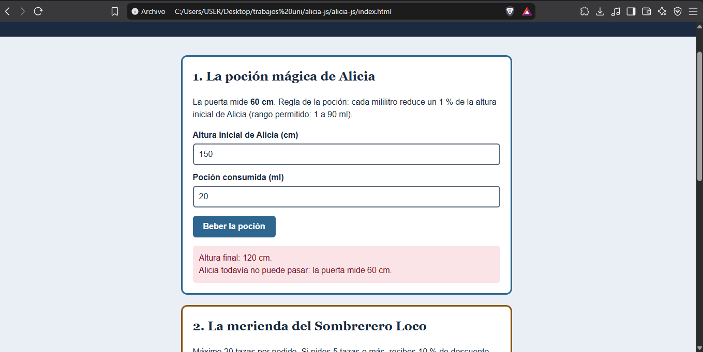
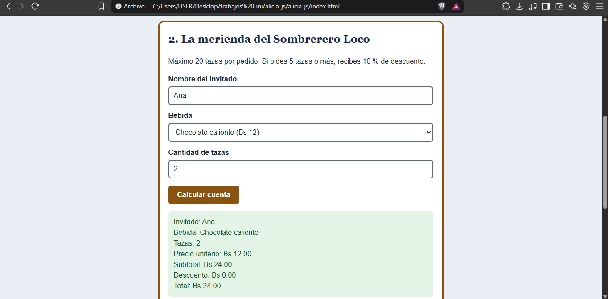
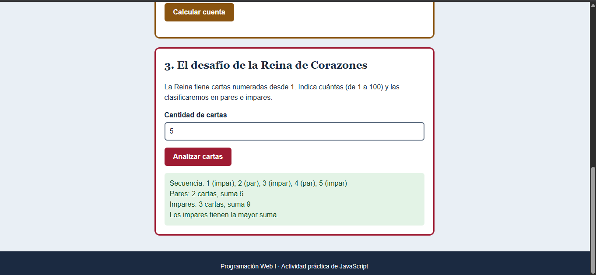

# Alicia en el país de las maravillas

Actividad práctica de **Programación Web I**: tres aplicaciones con formularios HTML, CSS y JavaScript nativo (sin frameworks, sin Flexbox ni Grid).

- **Página publicada:** _(https://neerpss.github.io/Actividad-practica-Alicia-en-el-pais-de-las-maravillas/)_
- **Video explicativo:** _()_

## Cómo usarla
1. Descarga o clona el repositorio.
2. Abre `index.html` en el navegador.
3. Completa un formulario y presiona el botón; el resultado aparece debajo, sin recargar. Puedes cambiar los valores y repetir.

## Estructura
```
index.html
css/estilos.css
js/comun.js        (función mostrarMensaje)
js/ejercicio1.js   (poción mágica)
js/ejercicio2.js   (merienda del Sombrerero)
js/ejercicio3.js   (Reina de Corazones)
evidencias/        (capturas de pantalla)
```

## Explicación del código

### Conceptos usados
- **`const` / `let`:** `const` para valores que no cambian (altura de la puerta, precios máximos); `let` para los que cambian (contadores y sumas del ejercicio 3).
- **`if / else if / else`:** elige un camino según una condición (validaciones y resultados).
- **`switch`:** elige un caso según el valor de una variable (precio de la bebida).
- **`for`:** repite un bloque un número conocido de veces (recorre las cartas de 1 a n).
- **Funciones:** `mostrarMensaje`, `calcularNuevaAltura`, `obtenerPrecio`, y la función que atiende cada evento `submit`.
- **`document.getElementById()`:** busca un elemento por su `id`.
- **`value`:** texto que el usuario escribió (siempre es texto; se convierte con `Number()`).
- **`textContent`:** escribe texto en la página (el resultado o el error).
- **`addEventListener("submit", ...)`:** ejecuta una función cuando se envía el formulario.
- **`preventDefault()`:** evita que el formulario recargue la página.

### Ejercicio 1: La poción mágica
- **Entradas:** altura inicial (cm) y poción (ml).
- **Regla:** `nuevaAltura = altura − (altura × ml) / 100` (cada ml reduce 1 % de la altura inicial). La puerta mide 60 cm.
- **Validaciones:** campos vacíos o no numéricos; altura > 0 y ≤ 300; poción entre 1 y 90 ml.
- **Salida:** altura final y mensaje: puede pasar (≤ 60 cm), no puede pasar, o error de datos.

### Ejercicio 2: La merienda del Sombrerero
- **Entradas:** nombre, bebida (4 opciones) y tazas.
- **Precios (Bs):** té 8, chocolate 12, café 10, limonada 7, obtenidos con `switch`.
- **Validaciones:** nombre no vacío, bebida elegida, tazas entero entre 1 y 20.
- **Procesamiento:** `subtotal = precio × tazas`; si `tazas >= 5` hay 10 % de descuento; `total = subtotal − descuento`.
- **Salida:** nombre, bebida, tazas, precio unitario, subtotal, descuento y total.

### Ejercicio 3: La Reina de Corazones
- **Entrada:** cantidad de cartas (entero entre 1 y 100).
- **Procesamiento:** un `for` recorre de 1 a n; con `numero % 2 === 0` decide si es par o impar, y acumula cantidad y suma de cada grupo.
- **Salida:** secuencia clasificada, cantidades, sumas y el grupo con mayor suma (o empate; con este rango no ocurre, pero el código lo contempla).

### Errores frecuentes
- Olvidar `preventDefault()`: la página se recarga y el resultado desaparece.
- Usar `value` sin convertir: `"5" + "3"` da `"53"` en vez de 8.
- Olvidar `break` en un `case` del `switch`: se ejecutan los casos siguientes.
- Escribir `i <= n` como `i < n` en el `for`: se pierde el último número.
- Confundir `=` (asignar) con `===` (comparar).

### Ejercicio 1 (puerta de 60 cm)
| # | Entrada (altura, ml) | Esperado | Obtenido |
|---|---|---|---|
| 1 | 150, 60 | Altura 60 cm; puede pasar |Altura final: 60 cm.
¡Alicia puede pasar por la puerta! |
| 2 | 150, 20 | Altura 120 cm; no puede pasar |Altura final: 120 cm.
Alicia todavía no puede pasar: la puerta mide 60 cm. |
| 3 | 100, 40 | Altura 60 cm (límite); puede pasar |Altura final: 60 cm.
¡Alicia puede pasar por la puerta! |
| 4 | −5, 10  | Error: altura inválida |La altura debe ser mayor que 0 y no pasar de 300 cm. |
| 5 | 150, 91 | Error: poción fuera de rango |La poción debe estar entre 1 y 90 ml. |
| 6 | (vacío), 10 | Error: completar campos |Completa los dos campos con números. |

### Ejercicio 2
| # | Entrada (nombre, bebida, tazas) | Esperado | Obtenido |
|---|---|---|---|
| 1 | Ana, Chocolate, 2 | Subtotal 24, descuento 0, total Bs 24.00 |
Invitado: Ana
Bebida: Chocolate caliente
Tazas: 2
Precio unitario: Bs 12.00
Subtotal: Bs 24.00
Descuento: Bs 0.00
Total: Bs 24.00 |
| 2 | Luis, Té, 5 | Subtotal 40, descuento 4, total Bs 36.00 |
Invitado: Luis
Bebida: Té de menta
Tazas: 5
Precio unitario: Bs 8.00
Subtotal: Bs 40.00
Descuento: Bs 4.00
Total: Bs 36.00 |
| 3 | Sofía, Café, 4 | Subtotal 40, descuento 0, total Bs 40.00 |
Invitado: Sofia
Bebida: Café
Tazas: 4
Precio unitario: Bs 10.00
Subtotal: Bs 40.00
Descuento: Bs 0.00
Total: Bs 40.00 |
| 4 | Pedro, Limonada, 20 | Subtotal 140, descuento 14, total Bs 126.00 |
Invitado: Pedro
Bebida: Limonada
Tazas: 20
Precio unitario: Bs 7.00
Subtotal: Bs 140.00
Descuento: Bs 14.00
Total: Bs 126.00 |
| 5 | (vacío), Té, 2 | Error: nombre vacío |Escribe el nombre del invitado. |
| 6 | Ana, Té, 2.5 | Error: tazas no entero |Las tazas deben ser un número entero entre 1 y 20. |
| 7 | Ana, Té, 21 | Error: máximo 20 tazas |Las tazas deben ser un número entero entre 1 y 20. |

### Ejercicio 3
| # | Entrada (cartas) | Esperado | Obtenido |
|---|---|---|---|
| 1 | 5 | Pares 2 (suma 6); impares 3 (suma 9); mayor: impares |Secuencia: 1 (impar), 2 (par), 3 (impar), 4 (par), 5 (impar)
Pares: 2 cartas, suma 6
Impares: 3 cartas, suma 9
Los impares tienen la mayor suma. |
| 2 | 1 | Pares 0 (suma 0); impares 1 (suma 1); mayor: impares |Secuencia: 1 (impar)
Pares: 0 cartas, suma 0
Impares: 1 cartas, suma 1
Los impares tienen la mayor suma. |
| 3 | 2 | Pares 1 (suma 2); impares 1 (suma 1); mayor: pares |Secuencia: 1 (impar), 2 (par)
Pares: 1 cartas, suma 2
Impares: 1 cartas, suma 1
Los pares tienen la mayor suma. |
| 4 | 100 | Pares 50 (suma 2550); impares 50 (suma 2500); mayor: pares |Pares: 50 cartas, suma 2550
Impares: 50 cartas, suma 2500
Los pares tienen la mayor suma. |
| 5 | 0 | Error: fuera de rango |Escribe un número entero entre 1 y 100. |
| 6 | 101 | Error: fuera de rango |Escribe un número entero entre 1 y 100. |
| 7 | 3.5 | Error: no es entero |Escribe un número entero entre 1 y 100. |

## Capturas

Aquí puedes ver el funcionamiento de la interfaz y los resultados:



